# team-39 Platanus Hack 26: Santiago ft. Buk Project

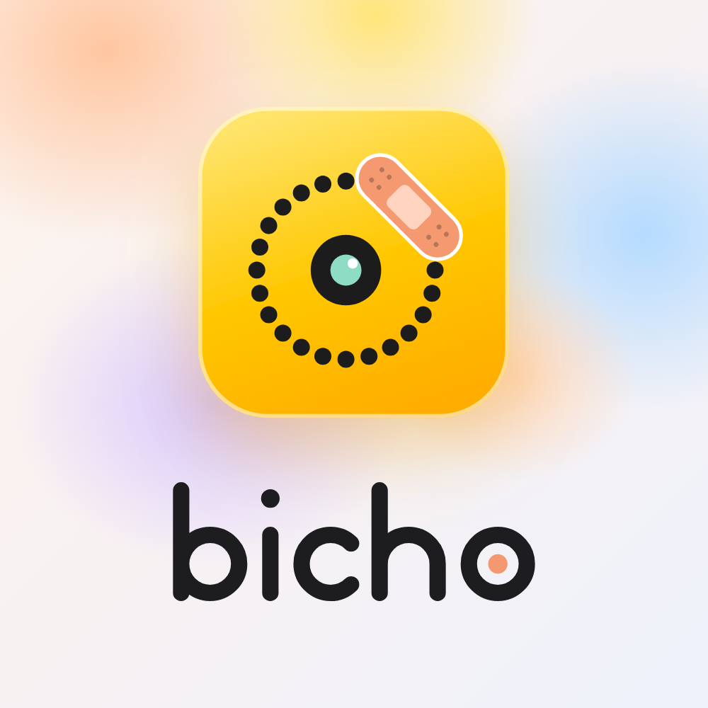

Track: 🔧 Hardware

team-39 (CRBRC)

- Rodrigo Requena ([@marketingmbc](https://github.com/marketingmbc))
- Cristian Ignacio Valdivia Ramirez ([@TesslaRay](https://github.com/TesslaRay))
- Carlos Escobar Valdivia ([@tali-platoonic](https://github.com/tali-platoonic))
- Benjamín Patricio Gutiérrez Martínez ([@gutybv](https://github.com/gutybv))
- Renate Romina Rehbein Rehbein ([@rerro-r](https://github.com/rerro-r))

## Bicho, el bicho que se parcha solo

**Un robot que se programa solo.** Si le pides algo que no sabe hacer, escribe el código, se lo instala por WiFi y lo prueba. Si el código nuevo falla, vuelve solo a la versión anterior.

## La innovación: el harness

Que una IA escriba código no es nuevo. Lo nuevo es que el robot reescriba su propio firmware en vivo sin quedar inservible. De eso se encarga el harness que construimos:

1. **Oye.** [`bicho/oido.py`](bicho/oido.py) corta lo que oye en frases y les pone el ángulo de donde viene la voz, que entrega el ReSpeaker. Las frases van al relé ([`rele/`](rele/)), que las transcribe.
2. **Decide.** El Cerebro ([`cerebro/cerebro.mjs`](cerebro/cerebro.mjs)) decide con **Claude Haiku 5.5** (`claude-haiku-5-5`) si ignora la frase, responde, habla, usa un comando que ya sabe o **aprende**.
3. **Aprende.** Para escribir código usa **Claude Fable 5.2** (`claude-fable-5-2`) con seis herramientas: `inspeccionar_hardware`, `leer_archivo`, `escribir_archivo`, `instalar`, `probar_comando` y `mirar_imagen`. Parte del código que corre en el Pi (`{"cmd":"fuente"}`) y empaqueta una versión nueva en un `.tar.gz`.
4. **Se instala.** El paquete llega por el relé a `POST /update` de `bichod` ([`bicho/bichod.py`](bicho/bichod.py)), que lo prueba **antes de activarlo**: todos los `.py` tienen que compilar, y `comandos.py` y `sensores.py` tienen que cargar sin hardware (`BICHO_SIMULAR=1`). Si algo falla, responde `FALLO: …` y no cambia nada. El Cerebro lee el error, corrige y vuelve a intentar, hasta 4 instalaciones.
5. **Queda a prueba.** La versión nueva se activa (`releases/<versión>` y el enlace `current`), pero queda a prueba: si no se conecta al relé en 60 s o se cae 3 veces seguidas sin confirmar, `bichod` vuelve solo a la anterior y lo informa en `info.vuelta_atras`.
6. **Lo comprueba.** Con la versión ya corriendo, el Cerebro prueba el comando de verdad (y mira la cámara cuando corresponde) y anota la habilidad nueva en `habilidades.json`.

**El núcleo está protegido.** El Cerebro no puede reescribir `bichod.py` (red, relé y actualizador), `salida.py` (el canal a la web) ni `oido.py`, y tampoco `version.json` ni `install.sh` (lista `PROTEGIDOS` en `cerebro/cerebro.mjs`). Así, un mal aprendizaje no lo puede dejar incomunicado ni sin forma de volver atrás.

El contrato completo entre el bicho, la web, el relé y el Cerebro está en [`PROTOCOLO.md`](PROTOCOLO.md).

## Qué hicimos nosotros y qué hizo Bicho solo

- **El equipo** (trabajando con Claude Code): el cuerpo, el protocolo, `bichod` con la prueba y la vuelta atrás, el Oído, el relé, el Cerebro, bicho·dev y las reglas del harness.
- **Bicho solo:** lo que aprendió cuando se lo pedimos en voz alta o por escrito. Nadie revisa ese código antes de que se instale.

Según bicho·dev el domingo 22 a las 4:53, Bicho tiene **24 habilidades: 12 se las programamos nosotros y 12 las aprendió solo**. Las primeras horas le programamos todo, y lo último de esa etapa fue enseñarle a aprender (sábado 21, 8:00). Desde ahí aprendió 12 habilidades solo y nosotros le sumamos 6. En promedio aprende algo nuevo en 3 min 57 s.

Dónde verlo:

- **bicho·dev → Habilidades**, la primera sección: lo último que aprendió, lo que sabe hacer y el gráfico «Lo que sabe hacer, hora a hora», que separa lo que aprendió solo de lo que le programamos.
- **[`bicho/habilidades.json`](bicho/habilidades.json)**, la lista base, con `origen: "equipo"` o `"solo"`. Trae las 12 del equipo y 4 de las que aprendió solo, que ya bajamos al repo con el pedido, los archivos y las líneas que escribió. Por ejemplo, [`bicho/flujo.py`](bicho/flujo.py) y [`bicho/flujo2.py`](bicho/flujo2.py) los escribió él cuando le pedimos usar los sensores de flujo óptico.
- **El código que aprende vive en la Raspberry Pi.** Cada aprendizaje se instala directo en el Pi, sin pasar por git, así que el repo no tiene todo lo que sabe. bicho·dev junta la lista del repo con la copia que manda el Pi y con los eventos del Cerebro. Para traer ese código al repo, alguien lo baja con `{"cmd":"fuente"}` y lo sube.

## Hardware: cómo quedó armado

Así está Bicho el domingo 22 a las 7:16. Las fotos salen de los videos del armado; los originales están en [Drive](https://drive.google.com/drive/folders/1UmriXySAsqis-VwTYOaZxrACf3ibyF0G).

| | |
|---|---|
| 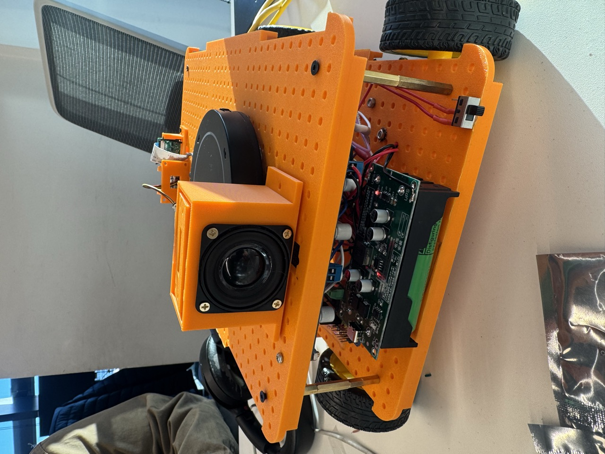 | 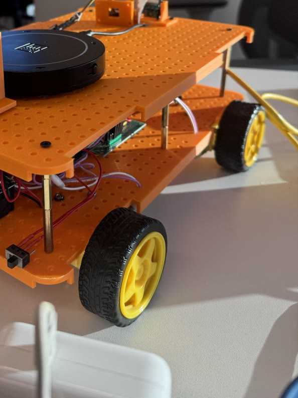 |
| **Arriba:** parlante en su caja impresa, ReSpeaker (el disco negro) y cámara CSI en su soporte al frente. | **Al medio:** UPS con su celda 18650, interruptor y la electrónica entre las dos placas. |
| 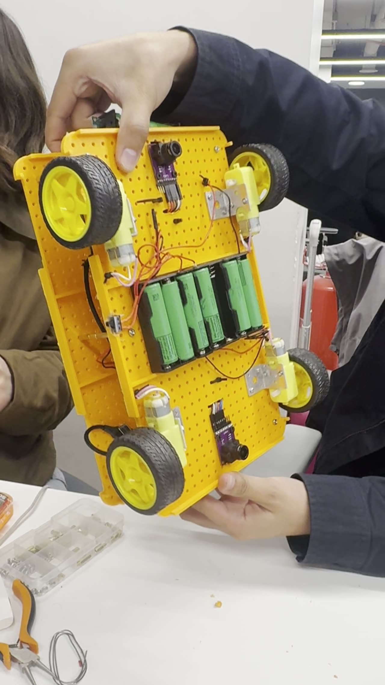 | 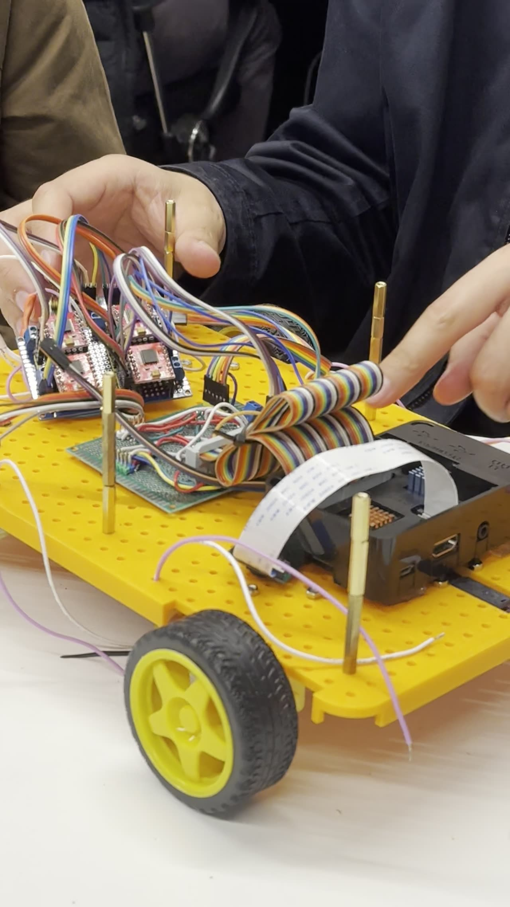 |
| **Abajo:** 8 celdas 18650 en dos portapilas (pack 2S4P para motores y servos), los 4 motores TT con escuadras metálicas y los sensores de suelo. | **Piso de la electrónica:** Raspberry Pi 3 en su caja, cinta de la cámara, los dos PCA9685 y los drivers TB6612, cableados con cintas de colores. |
| 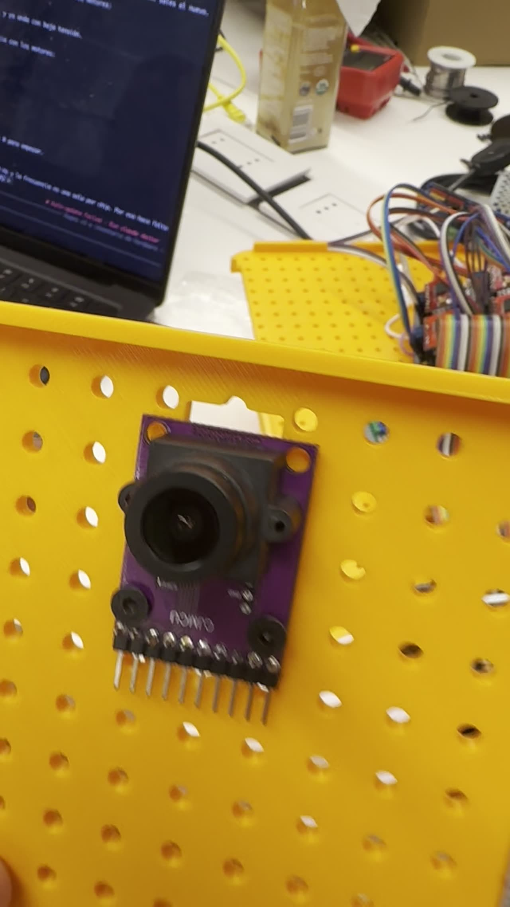 | 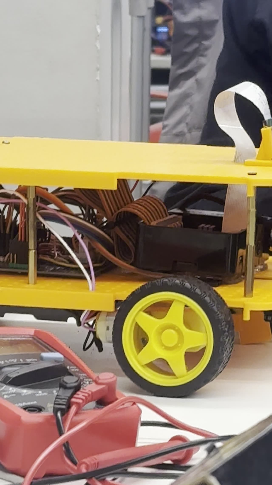 |
| **Sensor de flujo óptico** ADNS-3080 atornillado bajo la placa, mirando al suelo. | **De lado:** separadores de bronce entre placas y la cinta de la cámara subiendo al frente. |

**Lo que tiene hoy, pieza por pieza:**

| Parte | Qué es | Cómo lo usa Bicho |
|---|---|---|
| Cerebro local | Raspberry Pi 3 Model B con `bichod` como servicio (Python, solo la librería estándar) | Corre los módulos de `bicho/`, prueba cada parche antes de activarlo y vuelve atrás si falla |
| Oído y voz | ReSpeaker XVF3800 por USB, con anillo de 12 LED, más un parlante en su caja impresa | Frases y ángulo de la voz (`oido.py`), sonidos y voz (`speaker.py`, `anillo.py`) |
| Ojo | Cámara CSI ov5647 en el soporte frontal | Imágenes para la web y el Cerebro: comandos `camara` (hasta 6 por segundo desde la v0.37.0) y `foto` |
| Ruedas | 4 motorreductores TT 1:48, 2 drivers TB6612 y un PCA9685 en I2C 0x40 | `motores.py` y `descubrir.py`, que encontró solo qué canal mueve cada rueda |
| Servos | Segundo PCA9685 en I2C 0x41, a 50 Hz | `servos.py`, listo para el brazo (por desarrollar) |
| Odometría | 2 sensores de flujo óptico ADNS-3080 por SPI, bajo el chasis | `flujo.py` y `flujo2.py`, que escribió él solo |
| Energía | 8 celdas 18650 (2S4P) para la potencia; UPS con su propia celda para la Pi; interruptor | Lógica y potencia separadas, para que un motor trabado no reinicie la Pi |
| LiDAR | EAI S850 en su soporte impreso | Montado, pero todavía sin módulo (por desarrollar) |
| Cuerpo | 2 placas impresas de 32 × 20 cm con rejilla M3 cada 10 mm, separadores de bronce, soportes impresos y 6 paneles laterales a presión | STL, bandejas y guía en [`diseno/`](diseno/) |

El modelo 3D completo, pieza por pieza y con los sensores en vivo, se ve en bicho·dev → **Gemelo 3D**. El inventario del equipo está en bicho·dev → **Inventario**.

Diseñamos un brazo de 4 servos, pero Bicho anda sin brazo. El brazo quedó como feature por desarrollar (ver más abajo).

## Esquemáticos

El esquemático de conexiones (A3, 4 hojas) está en [`diseno/fuentes/esquematico-conexiones.pdf`](diseno/fuentes/esquematico-conexiones.pdf). Es la **propuesta inicial**. En el robot armado cambió una cosa: el ESP32-CAM se descartó y la Raspberry Pi maneja directo el bus I2C (PCA9685 0x40 para los motores, PCA9685 0x41 para los servos). El resto de las redes, las direcciones I2C y la alimentación siguen como en las hojas.

| | |
|---|---|
| **1 · Señales y control.** Pi, bus I2C, PCA9685, TB6612 y motores. | **2 · Alimentación.** Baterías 18650, UPS, LM2596 y masas. |
| [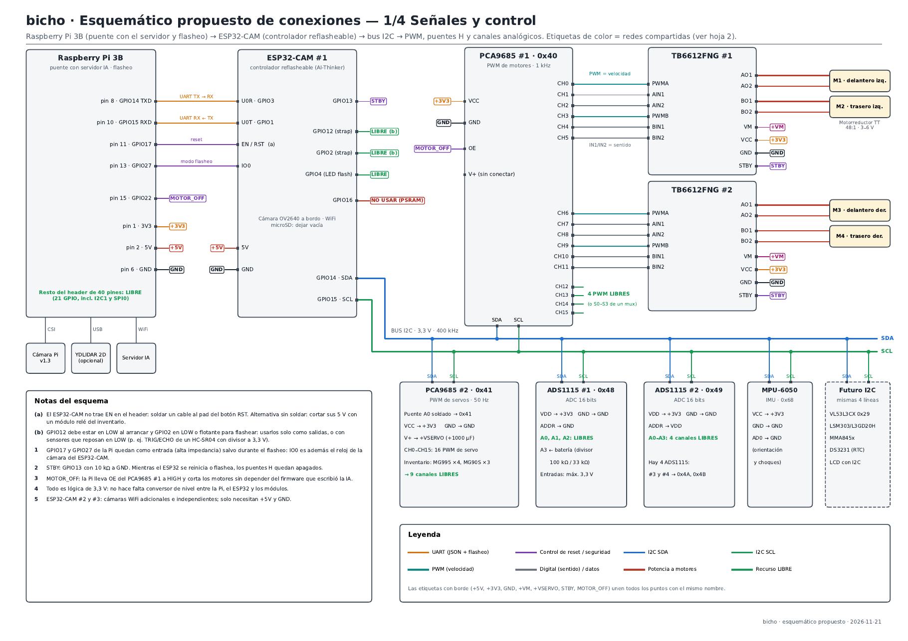](docs/esquematicos/esquematico-1.png) | [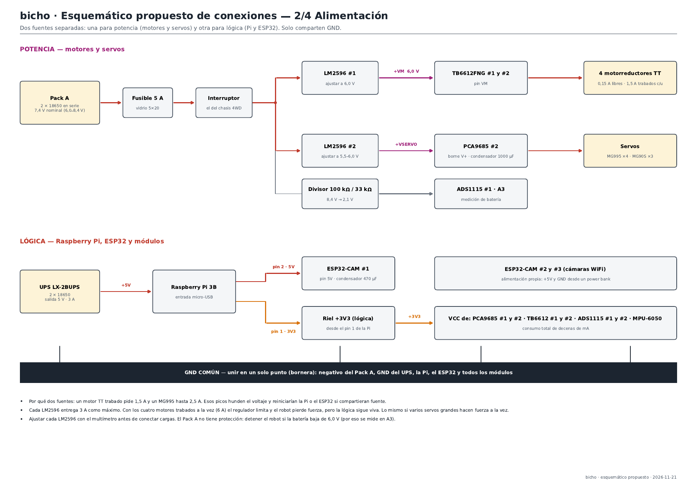](docs/esquematicos/esquematico-2.png) |
| **3 · Tabla de cableado.** Pin por pin. | **4 · Recursos libres, flasheo y pendientes.** |
| [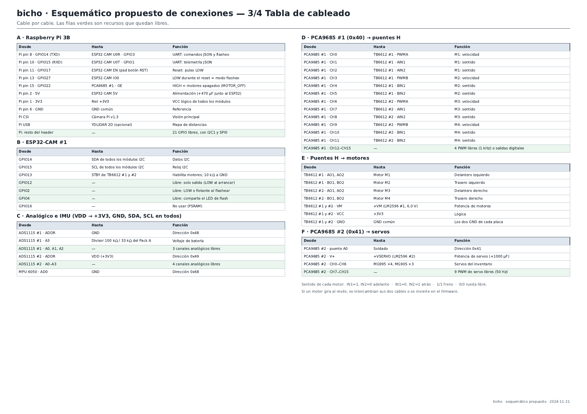](docs/esquematicos/esquematico-3.png) | [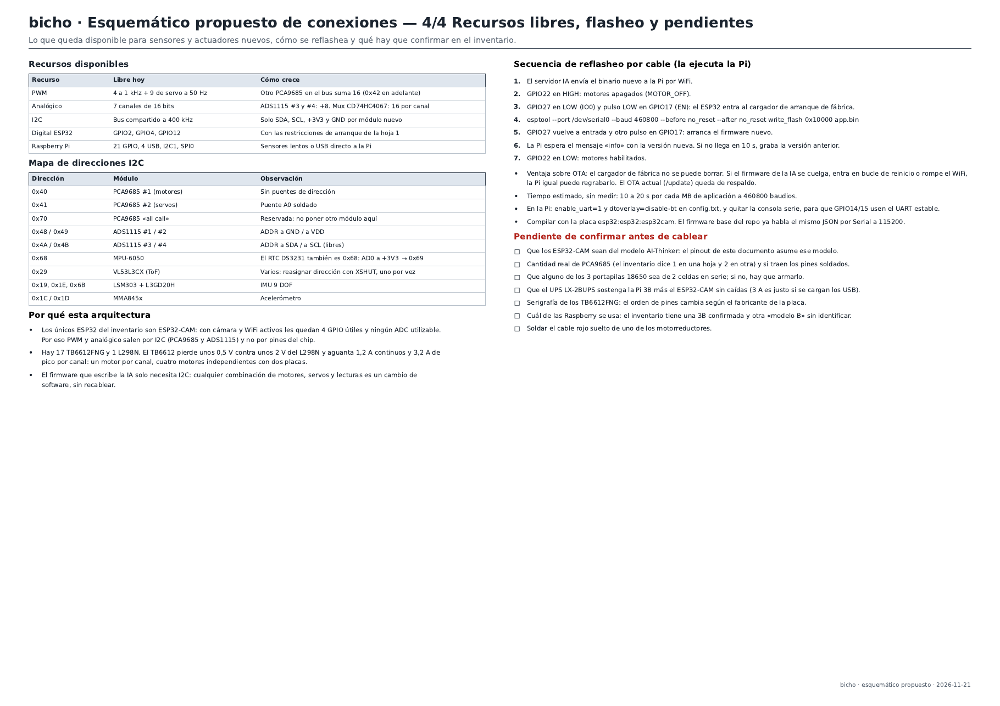](docs/esquematicos/esquematico-4.png) |

## Por desarrollar

Esto quedó diseñado o empezado, pero no es parte de lo que Bicho hace hoy. El detalle de cada feature, con estado y lo que falta, está en [`docs/POR-DESARROLLAR.md`](docs/POR-DESARROLLAR.md).

- **Brazo de 4 servos** ([`diseno/imprimir/brazo_v4/`](diseno/imprimir/brazo_v4/)): diseño final, archivos para tres impresoras, modelo BIM y la vista **Brazo** en bicho·dev. El firmware ya tiene el comando `servo`. Falta imprimirlo y montarlo.
- **LiDAR 2D**: el soporte está impreso. Falta el módulo en el Pi.
- **Señas con la mano** ([`handtracking/tracker/senas.py`](handtracking/tracker/senas.py)): le enseñas una seña con la voz frente a su cámara y la reconoce. Está probado contra el relé, pero falta la prueba con el robot real.
- **Manejar con las manos** ([`handtracking/unity/`](handtracking/unity/)): app Unity con gestos y parada de emergencia que entra por el relé. Falta probarla con los motores.
- **Gemelo digital**: las pestañas **Gemelo 3D** y **Manos** de bicho·dev, con el robot completo y los sensores en vivo. Falta el deploy.

## Mapa del repo

| Carpeta | Qué hay |
|---|---|
| [`bicho/`](bicho/) | `bichod` y los módulos que corren en el Pi: sensores, comandos, cámara, motores, anillo y oído. La versión está en `version.json`. |
| [`cerebro/`](cerebro/) | El Cerebro: decide y aprende con Claude, conectado al relé. |
| [`rele/`](rele/) | El relé (Node, sin dependencias): une al bicho con la web y el Cerebro desde cualquier red, y transcribe lo que oye. |
| [`web/`](web/) | **bicho·dev**, el panel (Vite + React): habilidades, firmware, sensores, Oído, Cerebro, consola, versiones, simulador e inventario. Las versiones publicadas del bicho están en `web/public/firmware/`. |
| [`diseno/`](diseno/) | El cuerpo en 3D: STL, bandejas para imprimir, soportes, paneles, el Taller 3D y el brazo v4 (por desarrollar). El esquemático está en `diseno/fuentes/`. |
| [`docs/`](docs/) | Esquemáticos en imagen y [features por desarrollar](docs/POR-DESARROLLAR.md). |
| [`handtracking/`](handtracking/) | Por desarrollar: señas y gestos con la mano (MediaPipe + Unity) que mandan comandos al bicho por el relé. |
| [`marca/`](marca/) | Logo, manual de marca y guion del pitch. |
| [`contexto/`](contexto/) | Estado, decisiones y bitácora del equipo: el contexto que comparten los Claude de cada integrante. |
| [`harness/`](harness/) | El boceto inicial de la capa de IA; lo que corre de verdad está en `cerebro/`. |

## Cómo correrlo

bicho·dev:

```bash
cd web && npm install && npm run dev
```

Se abre en http://localhost:5173. Sin el robot, en **Conexión** se elige **Simulador**.

- En la red local, el bicho responde en `http://bicho.local:8080/info` y por WebSocket en `ws://bicho.local:8080/ws`.
- Para instalar `bichod` en una Raspberry Pi: [`bicho/install.sh`](bicho/install.sh), con los pasos en [`bicho/README.md`](bicho/README.md).
- El relé y el Cerebro necesitan claves propias en un `.env` que no se sube al repo: ver [`rele/README.md`](rele/README.md) y [`cerebro/README.md`](cerebro/README.md).

## Links del equipo

- **Diagrama del proyecto (Excalidraw):** https://link.excalidraw.com/l/4iCyeooCs9Y/8iD0XuOrK3o
- **Fotos y videos del proceso (Drive):** https://drive.google.com/drive/folders/1-Ze_hGI7VpxI-U5A6CU_j8Gqs-QH9ReH, con la bitácora en [`contexto/proceso-fotos-y-videos.md`](contexto/proceso-fotos-y-videos.md)
- **Inventario original (Claude Sheet):** https://claude.ai/artifact/GBWrPQMav9q9mWqdLA92aG. Hoy vive en bicho·dev → Inventario.
- **Más links** (relé, impresión, marca y pitch): [`contexto/links.md`](contexto/links.md)
