# Kit de demo · fotos y videos para el pitch

Lo mejor de lo grabado el 21 y 22 de noviembre, ordenado como podría ir en el pitch o en el video de la entrega. Todos los originales están en Drive: [«2026-11-21 tarde y noche»](https://drive.google.com/drive/folders/1F9j-VuYKHk1OPFel2Dgp9BmWUvbrZm9W) (y lo de antes de las 6:20 en la carpeta madre). El detalle hora por hora está en [`proceso-fotos-y-videos.md`](proceso-fotos-y-videos.md).

**Antes de publicar:** lo marcado con 👤 muestra la cara de alguien. Pídanle el OK a esa persona, o usen solo los planos del robot. El repo es público, así que aquí solo se subieron vistas sin rostros (carpeta [`medios/`](medios/)).

## 1. Apertura: dónde estamos

- **[IMG_8010.MOV](https://drive.google.com/file/d/1-vfAePqAQku-xcIrr-k0y-50cEkFzG4d/view)** · 02:37 👤 *(sale gente: pedir OK)*: La sala de noche con el letrero «platanus hack [26] · 200 hackers, de cero a producto en 36 horas». Buen plano de apertura.

## 2. Del kit a Bicho

- **[IMG_8062.MOV](https://drive.google.com/file/d/1lKlxWWGACs8EOWkvnRMnFTG7zX-VIME7/view)** · 21:07 👤 *(sale gente: pedir OK)*: La primera versión de Bicho: el chasis negro de kit con ruedas amarillas, explicado a cámara. Es el «antes».
- **[IMG_8079.MOV](https://drive.google.com/file/d/1o-2Zf7Y6FYyghopbPjYAEFOtOkupNgF6/view)** · 02:18 👤 *(sale gente: pedir OK)*: El chasis nuevo de dos placas naranjas con sus cuatro ruedas («Está bonito»). Es el «después».
- **[IMG_8081.HEIC](https://drive.google.com/file/d/122HBu634p5GtSoDIvthh-4PiJjUC8EwV/view)** · 03:13 👤 *(sale gente: pedir OK)*: El chasis naranja en la mano, ya con ruedas.

## 3. Diseño que se vuelve pieza

- **[IMG_8040.MOV](https://drive.google.com/file/d/1-7qcIf3zbc_VP8Jh-JCBCmOgSgAFraSV/view)** · 17:22: En un solo plano: el modelo 3D en Blender y la misma placa imprimiéndose en la Bambu A2L.

  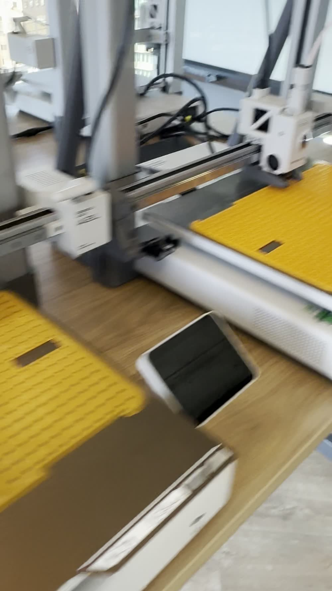
- **[IMG_8035.MOV](https://drive.google.com/file/d/1mRIm5h01URWOJaXaFv8mtIDlCVuU6Coc/view)** · 17:21: El mismo recorrido, de la pantalla a la impresora.

  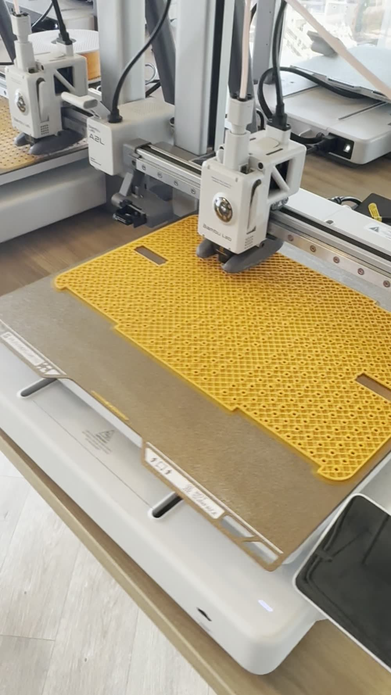
- **[IMG_8037.HEIC](https://drive.google.com/file/d/12ETetW1UqEpk0SABJmJfUgXcNH2DrYV5/view)** · 17:23: El modelo 3D de Bicho en Blender.

  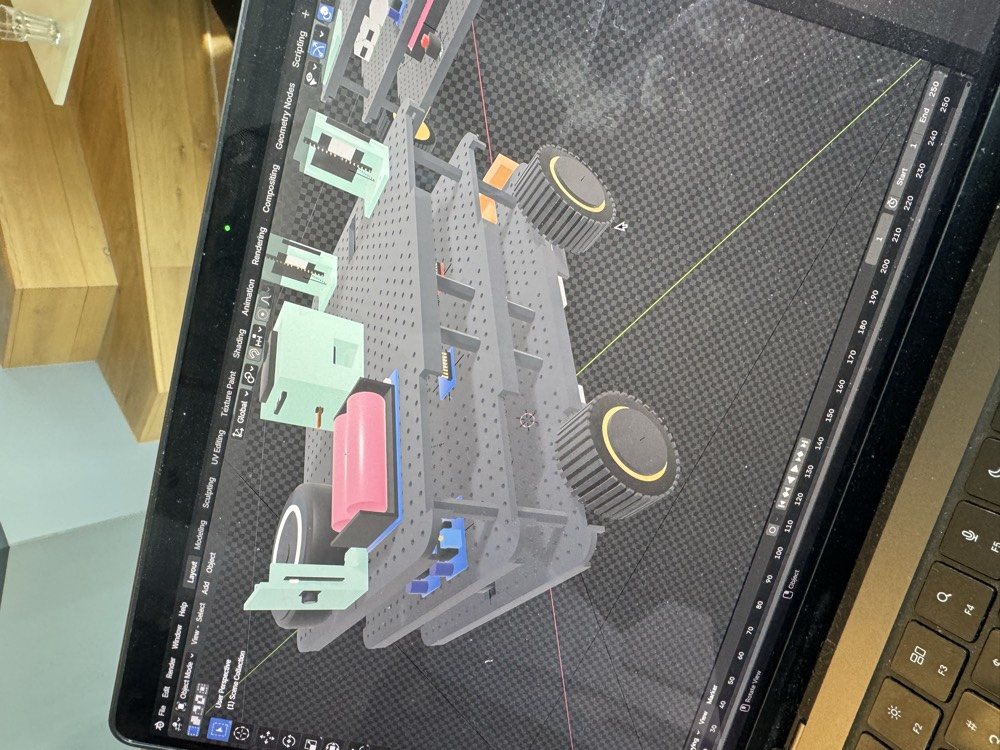
- **[IMG_8045.MOV](https://drive.google.com/file/d/1va-L12jGb-SNaPeJSG_bK7CLrUWURAzN/view)** · 18:26: Primer plano de la placa subiendo capa por capa.

  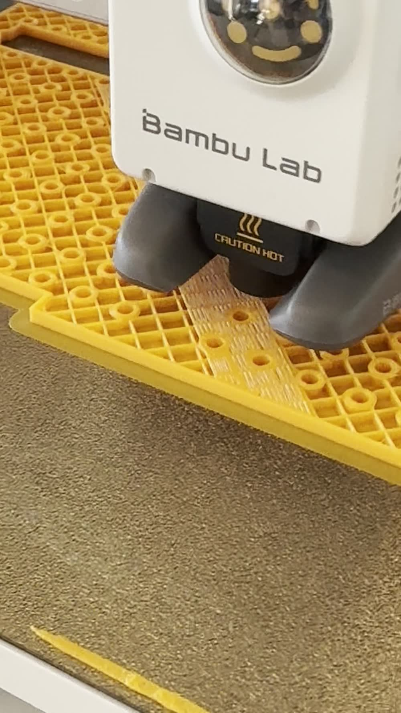
- **[IMG_8058.HEIC](https://drive.google.com/file/d/1edJRDjHRV3bTm1RGNCUBnNHaT1SbfzuT/view)** · 20:31: La placa del chasis recién terminada en la cama.

  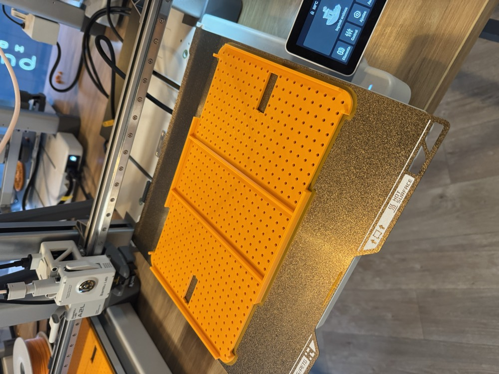
- **[IMG_8057.HEIC](https://drive.google.com/file/d/198kKxeKP3rfYIVsoCW8by-FgM8fFxoty/view)** · 20:30: «Impresión finalizada»: 6 h 8 min y 188 g.

  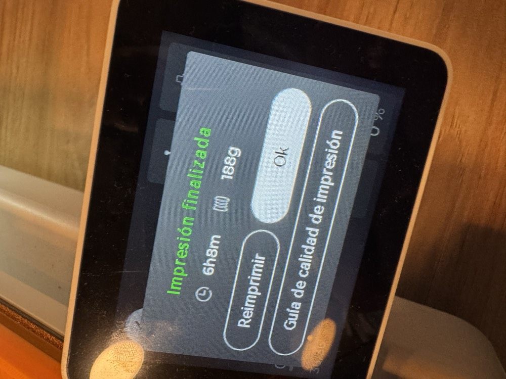

## 4. Los sentidos de Bicho

- **[IMG_8030.HEIC](https://drive.google.com/file/d/1J0w8ZKLpz6uSLbPfDERQifSdpbVbbi48/view)** · 16:27: El LiDAR EAI S850 con su placa adaptadora.

  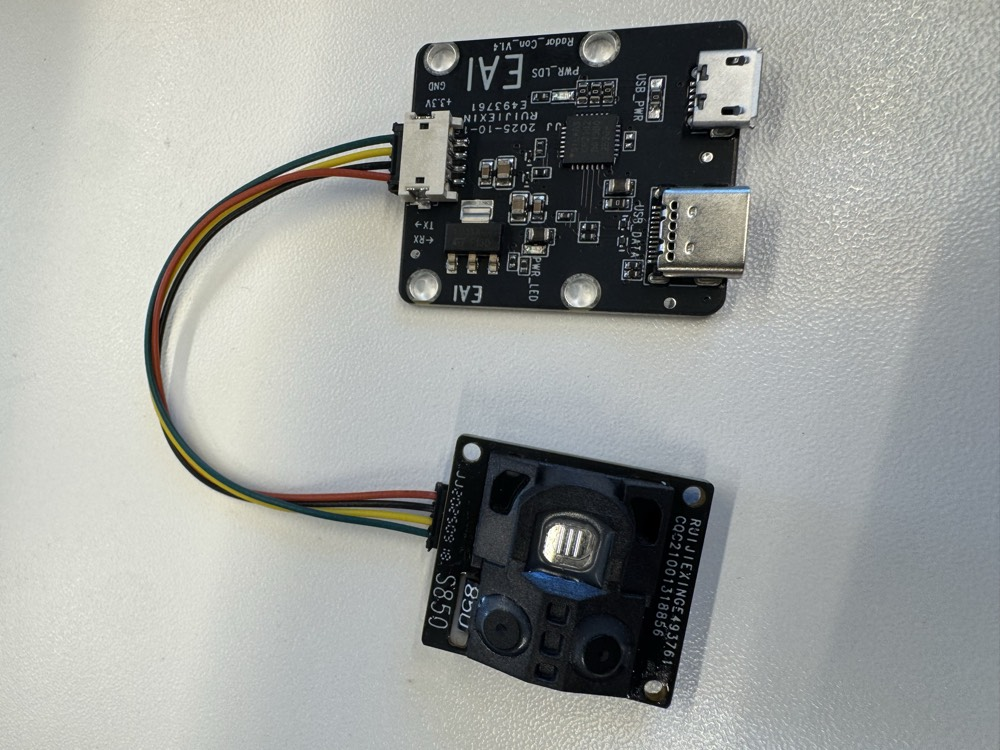
- **[IMG_8031.HEIC](https://drive.google.com/file/d/1S1VXusWp8ec3oZ1aQlLo6UselTH4EBvy/view)** · 16:27: La cámara Pi lista para montar.

  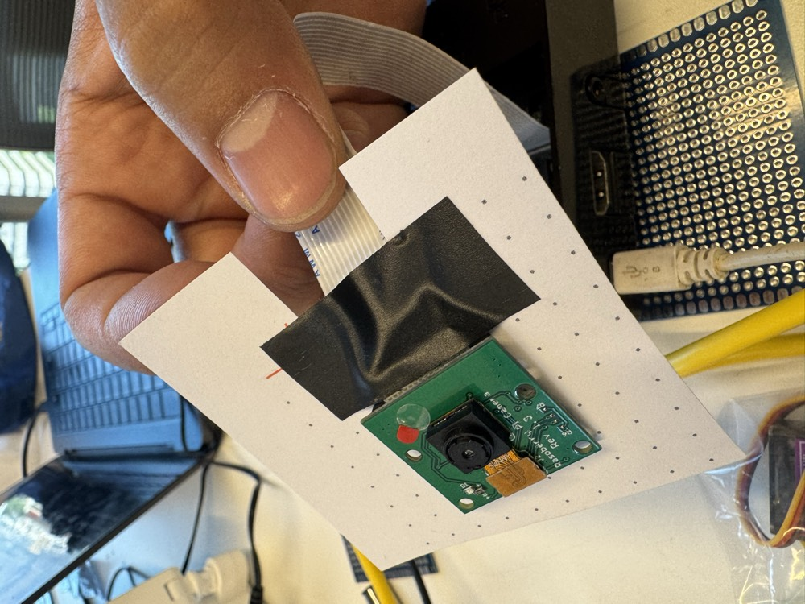
- **[IMG_8032.HEIC](https://drive.google.com/file/d/1fuEKYSD3RFXrc81w3IdYCi37Jgf6Kj1c/view)** · 16:27: La cinta de la cámara entrando en la Raspberry Pi.

  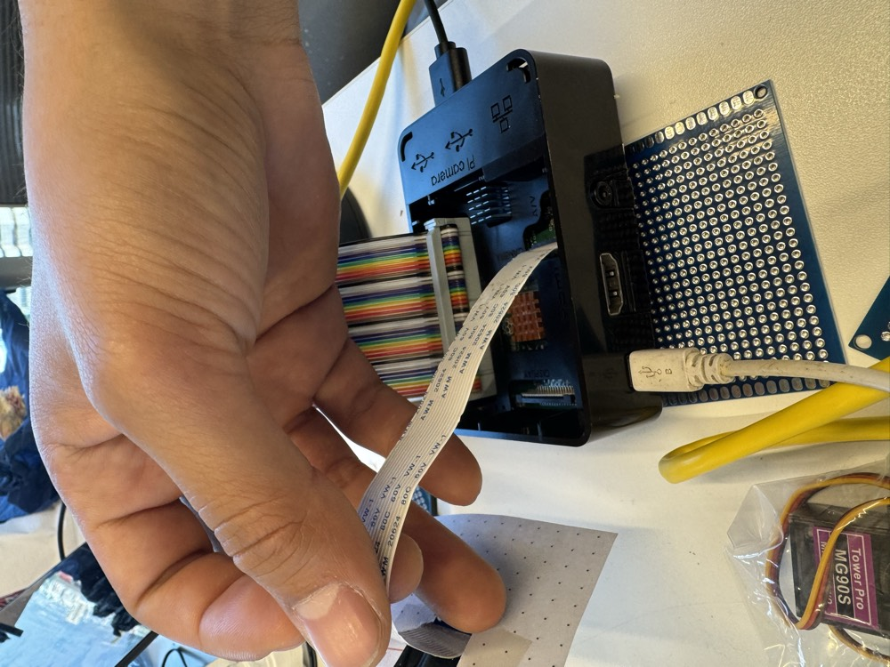

## 5. Lo central: Bicho aprende en vivo

- **[IMG_8065.MOV](https://drive.google.com/file/d/1dda7Odl12ajuu_ViXxgG1fML0Es8Qj7Q/view)** · 21:21 👤 *(sale gente: pedir OK)*: En el audio se oye que Bicho «aprendió» y agregó un comando nuevo solo, tras detectar un dispositivo en el bus. **Es el clip más importante del pitch:** escúchenlo para confirmar el momento exacto.
- **[IMG_8064.MOV](https://drive.google.com/file/d/1GvamCUa9q-zCP-IZxX8b6u-wcx1qeEcv/view)** · 21:20 👤 *(sale gente: pedir OK)*: Le piden «say hi» al robot.
- **[IMG_8063.MOV](https://drive.google.com/file/d/1qpsPL9waw8v3W9fZRNEKgkDi1UFFHQiA/view)** · 21:08 👤 *(sale gente: pedir OK)*: Del gemelo 3D de bicho·dev al robot real.
- **[IMG_8066.MOV](https://drive.google.com/file/d/1oNZ-R3yI9GeqMZUzs9DbOimTTblh0hcg/view)** · 21:30 👤 *(sale gente: pedir OK)*: Primeros planos del robot mientras explican qué se integró.

## 6. Armado de madrugada

- **[IMG_8078.MOV](https://drive.google.com/file/d/1aL9pcBvuB-z3fHhTp_QdeKxTSlYtGQm7/view)** · 02:17 👤 *(sale gente: pedir OK)*: Atornillando un motor TT con su rueda a la placa naranja.
- **[IMG_8082.MOV](https://drive.google.com/file/d/14foprIcRH1p8EMbJKkq45j2_j6Y4FvOc/view)** · 02:24: La placa por debajo: motores, cableado y la cámara.

  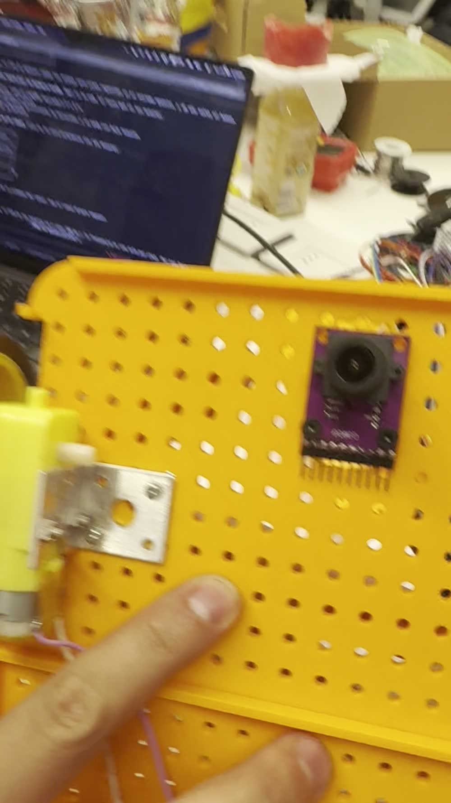
- **IMG_8083.MOV** · 03:12: El chasis con el portapilas al centro y la cámara.

## 7. Fallas reales que se resolvieron (hacen creíble la historia)

- **[IMG_8022.MOV](https://drive.google.com/file/d/1CPt3D8TxP53WpKAQ87pRq473DNDYqvX8/view)** · 05:50 👤 *(sale gente: pedir OK)*: «Murió el bicho»: se cayó la conexión con el robot.
- **[IMG_8075.HEIC](https://drive.google.com/file/d/1zsuKfvk9pRPLyytUZA5-MfoxbRAdeXFU/view)** · 02:16: Error 05004037 en la A2L a las 2 AM: el archivo estaba laminado para otra impresora. Se rehízo para el modelo correcto.

  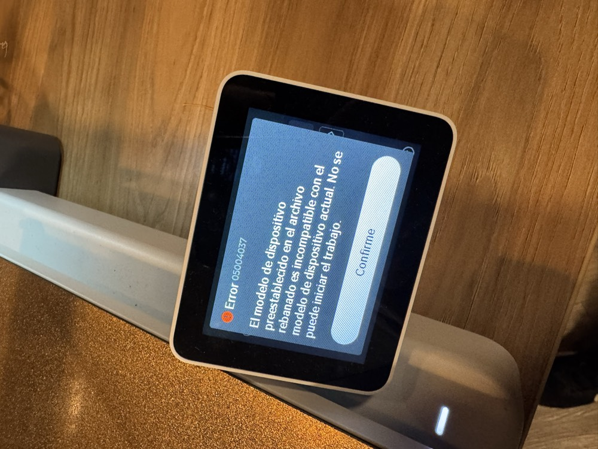
- **[IMG_8068.HEIC](https://drive.google.com/file/d/19pxEEe3j8_nF7h-TN_fg3j57EfzSProk/view)** · 21:45: La Sermoon D3 con el filamento cortado a la entrada del extrusor.
- **[IMG_8067.HEIC](https://drive.google.com/file/d/1JkACJ3vKi90GsmQReZbu_NN-XqFsD9Ut/view)** · 21:44: Las placas del brazo listas en la cama de vidrio de la CR-3040 (el brazo después se descartó).

  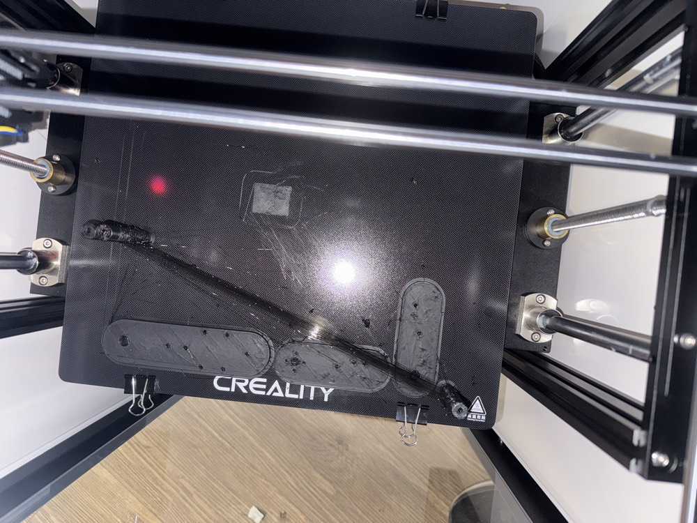

## 8. Ambiente

- **[IMG_8074.MOV](https://drive.google.com/file/d/1uoWg0TC9W5uAHKnsBdb8WKxOVGN_fTlW/view)** · 02:05 👤 *(sale gente: pedir OK)*: La sala de madrugada: gente programando y otros durmiendo en colchones inflables.
