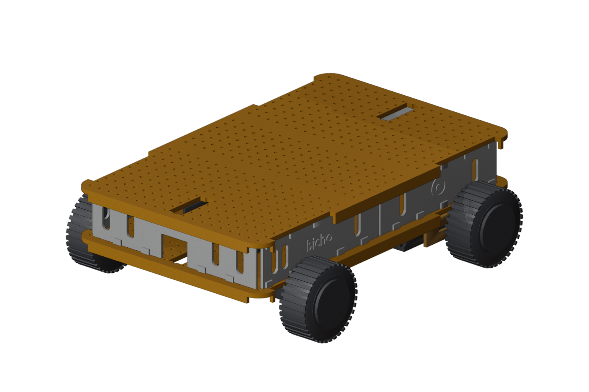

# Paneles laterales de Bicho (modelo de 2 placas)

Cierran los 4 costados del piso que queda entre la placa de abajo y la de arriba. Son 6 piezas en una sola impresión.

| Impresora | Archivo (copiar a la microSD) | Tiempo | PLA |
|---|---|---|---|
| **Bambu A1** | [`SD/A1_PANELES.gcode.3mf`](SD/A1_PANELES.gcode.3mf) | **2 h 36 min** | ~95 g |
| Bambu A2L | [`SD/A2L_PANELES.gcode.3mf`](SD/A2L_PANELES.gcode.3mf) | 2 h 27 min | 93 g |

Se imprime **uno de los dos**, no ambos. Ya van laminados y marcados para su impresora: placa Textured PEI, boquilla de 0,4, capa de 0,28 mm y 15 % de relleno. Las piezas salen acostadas, con la cara exterior hacia arriba, y no necesitan soportes.

## Piezas
- **P60 a P63:** costados de 146 mm, dos por lado. Llevan relieve: «bicho» en un costado y el ojo con la curita en el otro.
- **P64:** panel frontal de 174 mm.
- **P65:** panel trasero de 174 mm.

Los dos de 174 mm tienen una ventana abajo para que pasen los cables.

## Cómo se ponen (sin tornillos)
- Cada panel tiene **pasadores cuadrados de 2,6 mm** abajo y arriba, que entran en los agujeros de la rejilla.
  - Los costados van en la fila **y = ±90**, a 10 mm del borde.
  - El frontal y el trasero van en la fila **x = ±150**.
- Primero se calzan los pasadores de abajo en la placa de abajo. Después se curva levemente el panel para meter los de arriba en la placa de arriba. Si cuesta, se pueden cortar los pasadores de arriba y fijar el panel con un punto de silicona caliente.
- Los costados tienen una **muesca en x = ±40** para el nervio transversal de la placa de arriba. Quedan 12 mm hacia adentro del borde, así que no tocan las ruedas.

Se regeneran con `Blender -b -P diseno/blender/generar_paneles_laterales.py -- <salida>`.
