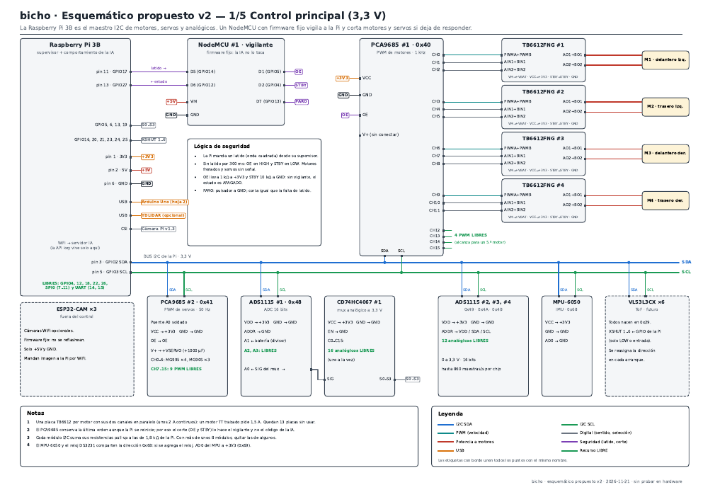
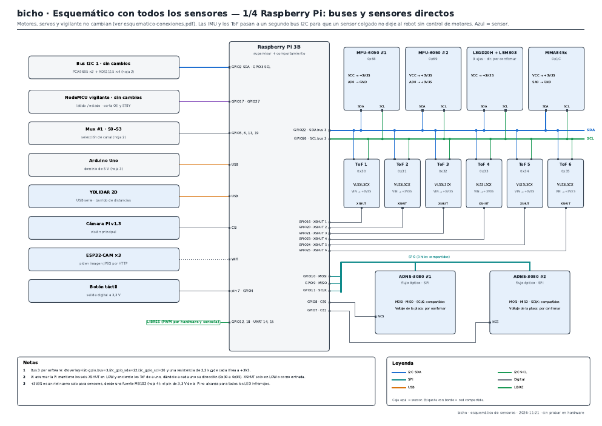
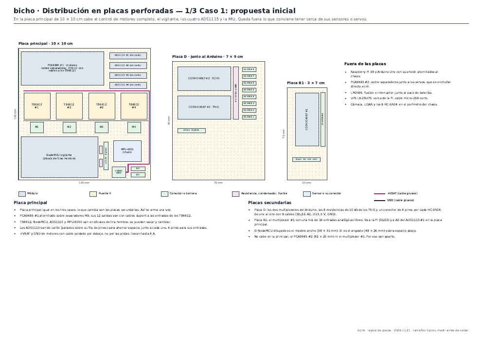

# Hardware: cómo evolucionó el diseño

Esta carpeta guarda los **primeros esquemas y la primera documentación** del hardware. No describen el producto final. Son las propuestas que hicimos en la madrugada del sábado 21, antes de armar. El robot cambió al construirlo. Lo que tiene de verdad está en el [README principal](../../README.md#hardware-cómo-quedó-armado), con fotos del robot terminado.

## La secuencia

| # | Documento | Qué proponía | Qué quedó en el robot |
|---|---|---|---|
| 0 | Boceto a mano del equipo (en el Discord del equipo) | Pi con cámara, micrófono y LiDAR por USB; 3 ESP32-CAM por WiFi; drivers con 4 motores; servos | La idea general: Pi al centro, cámara, micrófono USB, drivers y 4 motores |
| 1 | [`esquematico-conexiones.pdf`](../../diseno/fuentes/esquematico-conexiones.pdf) (v1, 4 hojas) | Pi + **ESP32-CAM** como controlador reflasheable por UART, con 2 PCA9685, 2 TB6612, 2 ADS1115 y MPU-6050 | El ESP32-CAM se descartó. Se mantuvieron los PCA9685, los TB6612 y las direcciones I2C |
| 2 | [`esquematico-conexiones-v2.pdf`](esquematico-conexiones-v2.pdf) (5 hojas) y [`DOCUMENTACION-V2.md`](DOCUMENTACION-V2.md) | La **Pi como maestro I2C**, un **NodeMCU vigilante** que corta motores y servos si la Pi deja de responder, y un **Arduino Uno** para lo de 5 V | Se usa la parte de la Pi como maestro I2C: PCA9685 0x40 para los motores y 0x41 para los servos, más los TB6612. El vigilante y el Arduino no se armaron |
| 3 | [`esquematico-sensores.pdf`](esquematico-sensores.pdf) (4 hojas) | Todos los sensores del inventario, con las IMU y los ToF en un segundo bus I2C | Quedaron la cámara CSI, el ReSpeaker y los 2 ADNS-3080 por SPI. El resto queda como posible ampliación |
| 4 | [`layout-placas.pdf`](layout-placas.pdf) (3 hojas) | Cómo repartir los módulos en placas perforadas de 10 × 10 cm | La electrónica quedó entre las dos placas impresas, cableada con cintas (fotos en el README) |

## Vistas (primera hoja de cada uno)

| v2 · conexiones | Sensores | Placas perforadas |
|---|---|---|
|  |  |  |

Las 4 hojas de la v1 están en imagen en [`docs/esquematicos/`](../esquematicos/) y en el README principal.

## Por qué cambió

- **Sin ESP32 ni vigilante.** Para que Bicho se reprogramara solo bastaba un computador: la Pi corre `bichod`, prueba cada parche y vuelve atrás si falla. Un segundo microcontrolador agregaba otro firmware que mantener en 36 horas.
- **El freno sigue fuera del código que escribe la IA.** El Cerebro no puede reescribir el núcleo (`bichod.py`, `salida.py`, `oido.py`; ver la lista `PROTEGIDOS` en `cerebro/cerebro.mjs`). Eso cumple el papel que tenía el vigilante.

Los archivos para imprimir el cuerpo (STL, bandejas y guía) también están en Drive: https://drive.google.com/drive/folders/1a9WasSzIEE1wSZMqfCm-AzRK_FrVOw_S
